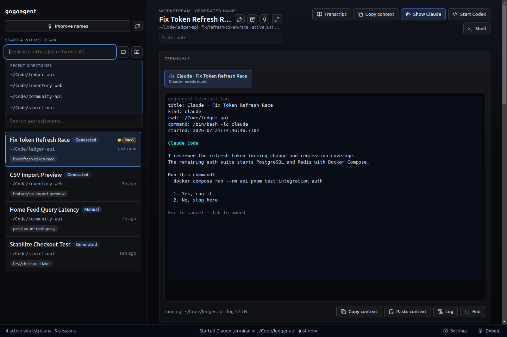

# gogoagent

gogoagent helps you run and organize Claude Code and Codex workflows, see
which agents need input, share useful memories between them, and pick up old
workstreams where you left off.


*Shown with generated repositories, transcripts, and terminal output. See the
[safe capture workflow](./docs/screenshots/README.md).*

## What it does

gogoagent groups related sessions and terminals into workstreams, so old work
doesn't disappear into a pile of terminal tabs. From a workstream, you can:

- Read a clean timeline of messages, tool calls, and touched files instead of
  scrolling through raw terminal output.
- See when an agent is waiting for input and jump straight to its terminal.
- Carry a short, reviewable memory handoff between Claude Code and Codex
  instead of pasting the whole transcript.
- Resume the latest Claude conversation or restart Codex with the context it
  needs.

> **Project status:** gogoagent runs from source; there is no installer yet.
> Most development happens on Linux. macOS should work but has had less
> testing.

## Quick start

You need:

- macOS or Linux with Git and Bash
- Node.js 20 or newer
- Corepack

The `claude` and `codex` CLIs are optional. Install either one if you want
gogoagent to launch it. Codex is also used for optional naming and lesson
extraction.

Check your setup:

```bash
node --version
corepack --version
```

If Node is installed but Corepack is not, `./start.sh` offers to install it
with npm after asking for permission. To install it yourself instead:

```bash
npm install --global corepack@latest
```

Then clone and launch:

```bash
git clone https://github.com/itsdchen/gogoagent.git
cd gogoagent
./start.sh
```

`./start.sh` installs missing packages, repairs Electron or `node-pty` when
needed, builds the app, starts or reuses the local sidecar, and opens Electron.
The first run needs network access and may take a few minutes.

To check everything without opening the app:

```bash
./start.sh --check
```

If `node-pty` has to build from source, macOS may need Xcode Command Line Tools
(`xcode-select --install`); Linux may need Python and standard C/C++ build
tools.

Existing Claude Code history under `~/.claude` appears on first launch. An
empty list is normal if there is no history yet. To start new work, choose a
directory, select **Claude**, **Codex**, or **Shell**, and press Start.

Memory sharing between Claude Code and Codex is on by default; either direction
can be turned off in Settings.



## What stays local

Coding transcripts and terminal logs can contain private code and sensitive
output. gogoagent keeps discovery, indexing, storage, terminal management, and
cross-agent memory handoffs on your machine.

The sidecar only accepts local connections. It uses a new auth token each time
it starts, and that token is never exposed to the app's UI. gogoagent does not
intentionally read Claude credentials or authentication files.

Two optional features can send selected context through your installed Codex
CLI:

- **Improve names** sends selected repo and branch names, clipped user or
  terminal messages, and touched paths.
- **Extract lessons** sends candidate lesson text and nearby conversation
  context.

The CLI may contact its configured model provider. You do not need either
feature to browse history or run terminals, and automatic naming is off by
default. Memory sharing is different: the handoff is built locally, and
nothing is sent until you review it in the new terminal.

<details>
<summary>Files gogoagent reads and writes</summary>

It reads Claude Code history from:

- `~/.claude/projects/**/*.jsonl`
- `~/.claude/history.jsonl`
- `~/.claude/sessions/*.json`
- `~/.claude/todos/*.json`

It stores its own data under:

- `~/.gogoagent/terminal-logs/` — terminal metadata and output
- `~/.gogoagent/cache/` — regenerable transcript indexes
- `~/.gogoagent/state/` — names, archives, and refined lessons
- `~/.cache/gogoagent/` — older data retained for migration

Terminal logs can contain commands and output from embedded terminals, so
treat `~/.gogoagent` as private. On first use, older saved state in
`~/.cache/gogoagent` is copied into `~/.gogoagent/state`; the original files
are left alone.

</details>

## How terminals stay alive

Live terminals run in a small background process called the sidecar, so closing
and reopening the window does not kill them. Ctrl+C stops Electron and any
sidecar started by that launch. A sidecar that was already running stays up.

`./start.sh` reconnects to the sidecar on port `43111`. It will not quietly
choose another port, because that would make running terminals appear to
vanish.

Restart only the window while keeping the sidecar:

```bash
./start.sh --frontend
```

Run a separate copy on another port:

```bash
GOGOAGENT_PORT=43112 ./start.sh
```

## Troubleshooting

Start with:

```bash
./start.sh --check
```

See [TROUBLESHOOTING.md](./TROUBLESHOOTING.md) for common setup and recovery
problems.

## Development

See [DEVELOPMENT.md](./DEVELOPMENT.md) for architecture, commands, sidecar
endpoints, verification, and safe screenshot regeneration. Contributors and
coding agents should also read [AGENTS.md](./AGENTS.md).

## Current limitations

- gogoagent discovers existing Claude Code history. It only knows about Codex
  work launched or logged through gogoagent.
- Worktree detection and touched-file lists are best-effort and can be wrong.
- You cannot manually merge or link workstreams yet.
