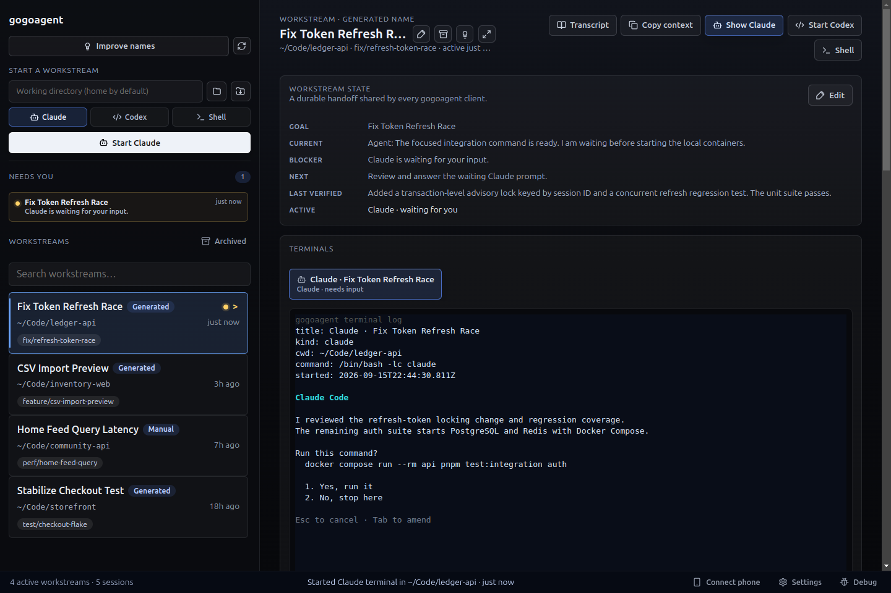

# gogoagent

gogoagent helps you run and organize Claude Code, Codex, and Antigravity CLI workflows, see
which agents need input, share useful memories between them, and pick up old
workstreams where you left off.



*Shown with generated repositories, transcripts, and terminal output. See the
[safe capture workflow](./docs/screenshots/README.md).*

## What it does

gogoagent groups related sessions and terminals into workstreams, so old work
doesn't disappear into a pile of terminal tabs. From a workstream, you can:

- Read a clean timeline of messages, tool calls, and touched files instead of
  scrolling through raw terminal output.
- See when an agent is waiting for input and jump straight to its terminal.
- Work from a prioritized **Needs you** inbox that explains whether an agent
  is waiting, finished, or blocked.
- Keep a durable goal, current state, blocker, next action, and last
  verification handoff on each workstream. The desktop brief distinguishes
  saved notes from recent transcript evidence and flags newer activity.
- Keep a working document for each workstream with an overview, current status,
  findings, decisions, open questions, next steps, and source sessions. Edit it
  directly or draft an update from recorded activity with the local Codex CLI;
  drafts are reviewed before saving.
- Open **Overview** with a readable reference article first, followed by a
  catch-up summary. The article has a table of contents and source links. An
  empty article stays compact until you draft or edit it. Agent handoff notes
  are collapsed below the article and show only fields you saved. Use the separate chat to ask
  about the workstream or review a proposed edit beside the current text.
  Activity and Terminal have their own tabs.
- Select a file path in a workstream terminal, then right-click and choose
  **Open selected file in reader**. Markdown is shown as an article; other
  UTF-8 text files are shown plainly. The reader is read-only and can keep
  useful files through **Files to read** beside the Working document heading.
  **Open file by path** works when a path is hard to select. The list stays on
  this desktop. The reader can read files in the workstream directory and AGY
  document files for AGY workstreams.
- Press Ctrl/Cmd+Shift+P to search workstreams. Press Ctrl/Cmd+Shift+L to
  switch between Overview, Activity, Terminal, and terminals in the current
  workstream. Both shortcuts work while a terminal has focus. In either picker,
  use arrow keys and Enter. Overview and running agents appear first in the
  current workstream picker; workstreams with agents needing input or running
  are prioritized among unpinned workstreams. In the workstream picker, Alt+P
  pins or unpins the selected workstream, and Alt+↑/↓ changes pinned order.
  Pinned sidebar cards also have arrow buttons. Press F1 for shortcut help.
  The order is saved on this desktop.
- Catch up from a short **Since your last visit** list of current attention,
  saved updates, and recent source-linked activity. Subtle color markers identify
  each kind of item; Activity holds the longer history.
- Choose Dark, Light, or System appearance in desktop Settings. The terminal
  keeps its dark palette for readable agent output.
- Queue follow-up investigations from Overview. Starting one creates a linked
  child workstream and pastes its question into an agent terminal for review.
  Findings in the child article can be proposed back to the parent article.
- Carry a short, reviewable memory handoff between Claude Code and Codex
  instead of pasting the whole transcript.
- Resume the latest Claude, Codex, or Antigravity CLI conversation from the
  workstream header, or choose an older session from Activity, after reviewing
  the handoff and current Git state. The header also opens a running agent.
- Continue a discovered Claude, Codex, or Antigravity CLI session from the paired phone UI after
  reviewing its workstream state and current repository; see shared new-since-
  last-view markers across phone and desktop.

> **Project status:** gogoagent runs from source; there is no installer yet.
> Most development happens on Linux. macOS should work but has had less
> testing.

## Quick start

You need:

- macOS or Linux with Git and Bash
- Node.js 20 or newer
- Corepack

The `claude`, `codex`, and `agy` CLIs are optional. Install the ones you want
gogoagent to launch. Codex is also used for optional naming and lesson
extraction.

Check your setup:

```bash
node --version
corepack --version
```

If Node is installed but Corepack is not, `./start.sh` offers to install it
with npm after asking for permission. To install it yourself instead:

```bash
npm install --global corepack@latest
```

Then clone and launch:

```bash
git clone https://github.com/itsdchen/gogoagent.git
cd gogoagent
./start.sh
```

`./start.sh` installs missing packages, repairs Electron or `node-pty` when
needed, builds the app, starts or reuses the local sidecar, and opens Electron.
The first run needs network access and may take a few minutes.

To check everything without opening the app:

```bash
./start.sh --check
```

If `node-pty` has to build from source, macOS may need Xcode Command Line Tools
(`xcode-select --install`); Linux may need Python and standard C/C++ build
tools.

Existing Claude Code history under `~/.claude`, Codex history under
`~/.codex/sessions`, and resumable Antigravity CLI conversation metadata under
`~/.gemini/antigravity-cli/cache` appear on first launch. An empty list is normal
if there is no history yet. To start new work, choose a directory, select
**Claude**, **Codex**, **AGY**, or **Shell**, and press Start.

Antigravity CLI resumes a selected conversation with `agy --conversation <id>`.
gogoagent indexes CLI conversation titles and workspaces, but does not yet read
Antigravity message history into its timeline. Conversations created
in the Antigravity app must first be imported into the CLI using its `/resume`
picker before gogoagent can offer direct resume. A conversation saved in the
CLI's workspace resume map can still be resumed when its title metadata has
not appeared yet; it is shown with a generic title until that metadata arrives.

Memory sharing between Claude Code and Codex is on by default; either direction
can be turned off in Settings.


## Remote sidecar, local desktop

You can keep repositories, agent CLIs, transcripts, and live terminals on a
remote Linux or macOS machine while running the full Electron window here. Use
the same gogoagent source version on both machines. On the remote machine, run
the sidecar under the SSH user that owns the workstreams:

```bash
corepack pnpm install --filter @gogoagent/sidecar...
corepack pnpm install --filter @gogoagent/mobile...
corepack pnpm --filter @gogoagent/shared build
corepack pnpm --filter @gogoagent/mobile build
corepack pnpm --filter @gogoagent/sidecar dev
```

Keep that process running, for example in `tmux`. Then, on your local desktop:

```bash
./start.sh --remote user@remote-host
```

The launcher builds the local UI, reads the sidecar's per-run token through
SSH, and creates a loopback-only SSH tunnel. It closes the tunnel when the
desktop window exits; the remote sidecar and its terminals keep running. SSH
host aliases in `~/.ssh/config` work. For a remote sidecar on another port, set
`GOGOAGENT_REMOTE_PORT` when launching the local frontend.

Type a working directory from the remote machine in the launcher. Directory
suggestions and validation use the remote filesystem; the local folder picker
is disabled. If the remote sidecar restarts, close and rerun the local attach
command to read its new token. SSH port forwarding must be allowed by the
remote SSH server.

Phone access started from this desktop runs on the remote sidecar host. The
phone must be able to reach that host over trusted Wi-Fi or a private VPN;
the desktop's SSH tunnel is only for the desktop window.

## Phone UI (preview)

The mobile web UI is designed for quick supervision away from the desktop. It
uses large text and tap targets and lets you:

- See the **Needs you** inbox and open a workstream.
- Read recent terminal output.
- See the agent's current prompt beside the saved workstream goal and next step when it needs a decision.
- Preview the agent's question in the Needs you inbox, and review a shared receipt after sending a choice.
- Tap numbered or yes/no choices from that prompt; stale choices are rejected if the prompt changes.
- Type and explicitly send feedback to a running Claude, Codex, or Antigravity CLI terminal.
- Review and edit the workstream's state capsule, or resume a discovered Claude,
  Codex, or Antigravity CLI session after reviewing the repository.

It intentionally cannot start arbitrary agents or shells or stop terminals.

Start gogoagent normally, select **Connect phone** in the footer, and choose
**Start phone access**. Scan the displayed QR code with your phone camera;
Safari or Chrome opens and pairs automatically. There is no separate phone app
to install, though you can add the page to your home screen afterward. A
six-digit code is available as a fallback.

The computer running the sidecar must remain powered on, and phone access must
remain enabled. The desktop window may close; the paired phone stays connected
while the sidecar runs. On the same Wi-Fi network, use the local-network connection.
Away from the computer's network, connect both devices through a private VPN
such as Tailscale and choose the private-VPN connection in the dialog.

See [Phone access](./docs/PHONE_ACCESS.md) for the complete setup, everyday
workflow, security notes, and troubleshooting steps.

The desktop controls a gateway owned by the sidecar. Explicitly stopping phone
access or stopping the sidecar ends the gateway. For development or headless
use, the gateway can still be started manually:

```bash
GOGOAGENT_MOBILE_HOST=0.0.0.0 \
GOGOAGENT_MOBILE_ALLOW_REMOTE=1 \
corepack pnpm mobile
```

The manual gateway prints a phone URL and a six-digit pairing code. Pairings
last up to 12 hours and are forgotten whenever the gateway stops. QR pairing
links expire after ten minutes and rotate immediately after use.

The gateway is loopback-only unless remote access is explicitly enabled or you
start it from the desktop's **Connect phone** dialog. A plain `http://`
connection is not encrypted, so do not expose this port to the public
internet. Use trusted private Wi-Fi for local access and a private VPN for
access away from home. For manual setups, you can bind to a specific private
address with `GOGOAGENT_MOBILE_HOST=<address>` and the same
`GOGOAGENT_MOBILE_ALLOW_REMOTE=1` opt-in. Set
`GOGOAGENT_MOBILE_SECURE_COOKIE=1` when the gateway is behind HTTPS.

## What stays local

Coding transcripts and terminal logs can contain private code and sensitive
output. gogoagent keeps discovery, indexing, storage, terminal management, and
cross-agent memory handoffs on your machine.

The sidecar only accepts local connections. It uses a new auth token each time
it starts, and that token is never exposed to either UI. The optional mobile
gateway proxies only a small set of named actions and uses its own pairing
session; it never sends the sidecar token to the browser. gogoagent does not
intentionally read Claude credentials or authentication files.

Four optional features can send selected context through your installed Codex
CLI:

- **Improve names** sends selected repo and branch names, clipped user or
  terminal messages, and touched paths.
- **Extract lessons** sends candidate lesson text and nearby conversation
  context.
- **Update from activity** sends recent workstream messages, saved state, and
  the current working document to draft a reviewed article update.
- **Ask this workstream** sends the current article, saved state, recent chat,
  and selected session excerpts to answer a question or propose an article edit.

The CLI may contact its configured model provider. You do not need these
features to browse history or run terminals, and automatic naming is off by
default. Memory sharing is different: the handoff is built locally, and
nothing is sent until you review it in the new terminal.

<details>
<summary>Files gogoagent reads and writes</summary>

It reads Claude Code history from:

- `~/.claude/projects/**/*.jsonl`
- `~/.claude/history.jsonl`
- `~/.claude/sessions/*.json`
- `~/.claude/todos/*.json`

It also reads Codex session rollouts from `~/.codex/sessions/**/*.jsonl`
(or `$CODEX_HOME/sessions` when `CODEX_HOME` is set).
It reads Antigravity CLI conversation metadata from
`~/.gemini/antigravity-cli/cache/conversation_metadata.json` and its CLI resume
map. Set `GOGOAGENT_AGY_CACHE_DIR` to use a different cache directory.
When you explicitly open a file in the desktop reader, the sidecar reads that
text file from the workstream directory or, for an AGY workstream, its CLI
document directory. It rejects files outside those areas and files larger than
2 MB. The reader does not edit the file.

It stores its own data under:

- `~/.gogoagent/terminal-logs/` — terminal metadata and output
- `~/.gogoagent/cache/` — regenerable transcript indexes
- `~/.gogoagent/state/` — names, archives, and refined lessons
- `~/.gogoagent/state/workstream-state.json` — user-reviewed workstream
  goals, status, blockers, next actions, and verification notes
- `~/.gogoagent/state/workstream-documents.json` — reviewed working documents
  and their source session links
- `~/.gogoagent/state/linked-investigations.json` — queued follow-ups and
  parent-child workstream links
- `~/.cache/gogoagent/` — older data retained for migration

Terminal logs can contain commands and output from embedded terminals, so
treat `~/.gogoagent` as private. On first use, older saved state in
`~/.cache/gogoagent` is copied into `~/.gogoagent/state`; the original files
are left alone.

</details>

## How terminals stay alive

Live terminals run in a small background process called the sidecar, so closing
and reopening the window does not kill them. Ctrl+C stops Electron and any
sidecar started by that launch. A sidecar that was already running stays up.

`./start.sh` reconnects to the sidecar on port `43111`. It will not quietly
choose another port, because that would make running terminals appear to
vanish.

Restart only the window while keeping the sidecar:

```bash
./start.sh --frontend
```

Run a separate copy on another port:

```bash
GOGOAGENT_PORT=43112 ./start.sh
```

## Troubleshooting

Start with:

```bash
./start.sh --check
```

See [TROUBLESHOOTING.md](./TROUBLESHOOTING.md) for common setup and recovery
problems.

## Development

See [DEVELOPMENT.md](./DEVELOPMENT.md) for architecture, commands, sidecar
endpoints, verification, and safe screenshot regeneration. Contributors and
coding agents should also read [AGENTS.md](./AGENTS.md).

## Current limitations

- Codex rollout indexing covers saved session messages and tool calls; some
  Codex surfaces or future rollout formats may show less detail.
- Worktree detection and touched-file lists are best-effort and can be wrong.
- You cannot manually merge or link workstreams yet.
- The phone UI is a source-run preview and currently polls for updates rather
  than using push notifications.

> **Preview:** gogoagent has not been released under an open-source license
> yet. Please don't redistribute it or use it commercially without permission.
